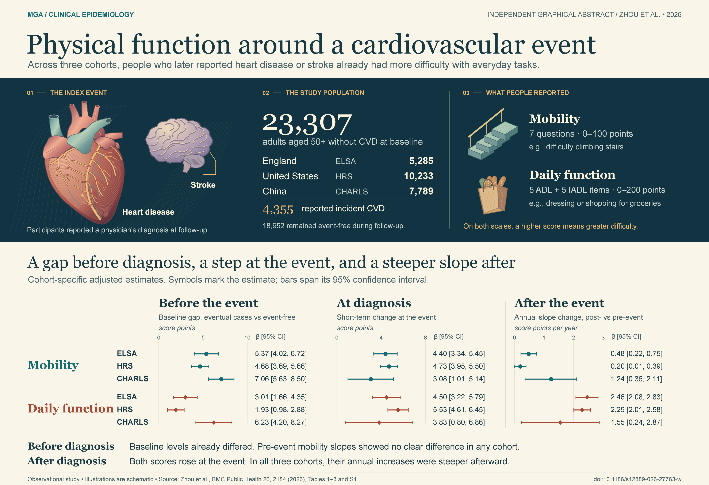
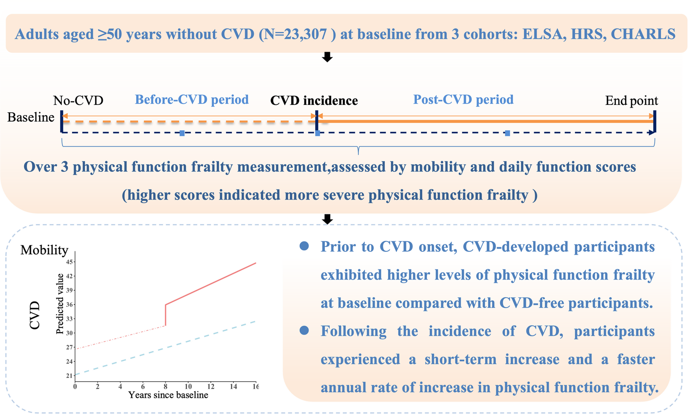
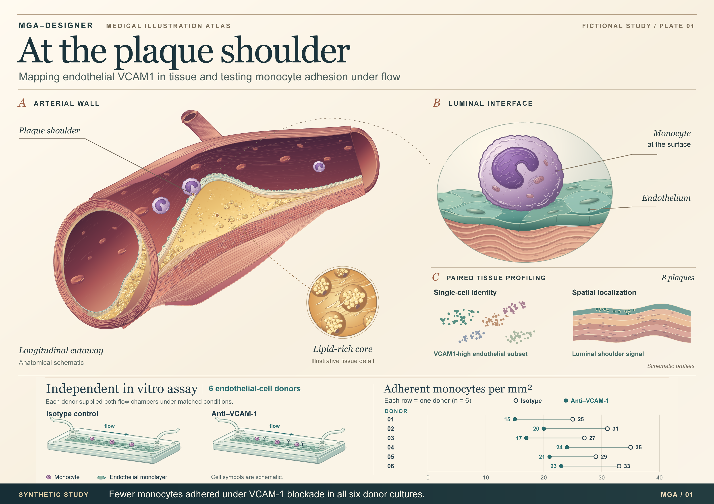
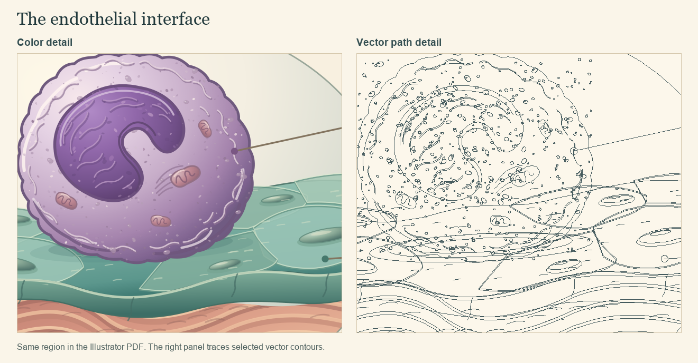

# MGA-Designer

**Medical Graphical Abstract Designer** · English | [简体中文](docs/README.zh-CN.md)

Turn a medical paper into a graphical abstract you can edit in Adobe Illustrator. Give MGA-Designer your manuscript and results tables. It traces each proposed finding to the paper, studies figures from comparable research, and shows you a sketch. You decide what the figure should say, how readers should move through it, and what can be left out.

[Download](https://github.com/hujizhou35-cmd/MGA-Designer/releases/latest) · [Study designs](#choose-a-layout-that-fits-the-evidence) · [Getting started](#use-it-with-your-manuscript) · [Issues](https://github.com/hujizhou35-cmd/MGA-Designer/issues)

## Two ways to illustrate a published study

What happens to everyday function around a first cardiovascular event? Zhou and colleagues followed 23,307 adults in England, the United States and China. For this comparison, MGA-Designer used the paper, its tables and its supplement. Its Illustrator artwork was finalized and recorded in Git before the authors’ graphical abstract was opened.

| MGA-Designer · independent illustration | Zhou et al. · published graphical abstract |
| :---: | :---: |
| [](docs/media/cvd-frailty.png) | [](docs/media/zhou-2026-published.png) |

The published figure follows people from baseline through diagnosis and shows a predicted mobility trajectory. The independent figure shows how mobility and daily function were measured, then sets out the results for each cohort before, at and after the event. Select either image to enlarge it.

[Design notes and source tables](docs/cvd-frailty.md) · [Editable Illustrator master](docs/media/cvd-frailty.ai?raw=true) · [Vector PDF](docs/media/cvd-frailty.pdf)

The published graphical abstract is reproduced unchanged. © The Author(s) 2026, Zhou et al., *BMC Public Health* **26**, 2184. It is covered by its own [CC BY-NC-ND 4.0 licence](https://creativecommons.org/licenses/by-nc-nd/4.0/). [Original paper](https://doi.org/10.1186/s12889-026-27763-w)

## Inside a laboratory illustration

### At the plaque shoulder · fictional teaching example

[](docs/media/demo.png)

Where does the endothelial *VCAM1* signal appear? The arterial cutaway locates the sampling sites in eight fictional plaque specimens. Does blocking VCAM-1 affect how many monocytes adhere under flow? That question belongs to a separate experiment using endothelial cells from six other donors. Each line in the plot joins two measurements from the **same** donor. The two sets of specimens stay separate throughout the figure.

[Read the design notes and synthetic counts](docs/demo.md) · [Download the editable Illustrator file](docs/media/plaque-atlas.ai?raw=true)

<details>
<summary>See the paths behind the illustration</summary>



The left panel shows the color artwork. The right panel shows the paths in the same area of the exported PDF. Open the AI file to select a path, change a fill, or edit a label.

</details>

## Choose a layout that fits the evidence

| What kind of paper are you illustrating? | What the sketch should make clear |
| --- | --- |
| Narrative review | Group related themes around a shared topic, compare competing explanations in parallel, or use a timeline for stages the literature actually describes. |
| Systematic review or meta-analysis | Start with the clinical comparison. Show the main synthesis and, for a pooled estimate, its confidence interval. Keep heterogeneity or evidence quality visible when it changes the interpretation. |
| Observational study, including public clinical databases | Show who was studied, how the exposure and outcome were measured, and which groups were compared. In a multicohort study, attach each analysis to the cohort that contributed it. |
| Clinical prediction model | Separate model development from evaluation. Place each performance measure beside the dataset on which it was calculated. |
| Public omics study, with or without experiments | Distinguish dataset discovery from independent replication. If an experiment tested expression, connect it to the expression finding. |
| Laboratory study | Draw the intervention, control and readout. Use a mechanism diagram where the experiments establish the relationship. |
| Bibliometric study | State which publications were included. Use a timeline for changes in themes or a network for collaborations, and explain what its nodes and lines measure. |

[Full guide to the 11 layouts](skills/mga-designer/references/layout-choices.md)

## Use it with your manuscript

1. **Connect Illustrator.** The assistant uses the Illustrator MCP server to send drawing commands to the desktop application. On first use, it draws a shape and editable text on a test layer, saves an AI file, reopens it and inspects an export. Later projects can reuse that connection.
2. **Trace the study.** The assistant reads the manuscript, tables and relevant supplement. For each method it records the sample, the question, the result and where to find it. If two numbers disagree, it checks the source before putting either on the figure.
3. **Review published examples.** The assistant opens figures from papers with similar questions and evidence. It explains what the layout can teach you and which claims are specific to the reference paper. If you name a journal, it also checks its artwork specifications and policy on AI assistance.
4. **Approve the sketch.** You get a visual draft, the reason for the proposed layout, and a table of what to keep, combine, move to the caption or omit. A second cohort, for example, may repeat an association or test an existing model. You can check what the connecting arrow means before any final artwork is drawn.
5. **Edit and export.** The assistant builds the figure in Illustrator using named layers, vector paths and editable text. It reopens the AI file, checks the plotted numbers against the source, and inspects the export at reading size. The default delivery is an **AI master, vector PDF, PNG preview and a short verification note**.

Attach the manuscript, the tables or supplements needed to verify the results, and the target journal if known. In Codex, start with:

> Use $mga-designer on the attached paper. Show me how the main finding follows from the measurements, propose a layout and explain your omissions. Wait for me to approve the sketch before drawing.

## Install one of the three editions

| Download | When to choose it | Setup |
| --- | --- | --- |
| [Single Markdown file](https://github.com/hujizhou35-cmd/MGA-Designer/releases/latest/download/SKILL.md) | Your assistant accepts instructions as a file. | Attach `SKILL.md`. It includes the full workflow and all guides. |
| [Codex project skill](https://github.com/hujizhou35-cmd/MGA-Designer/releases/latest/download/mga-designer.skill) | You want to use the skill in one project. | Extract the ZIP-format file so the resulting path is `.agents/skills/mga-designer/SKILL.md` inside your project. Rename the download to `.zip` if needed. Open a new project chat. |
| [Codex plugin](https://github.com/hujizhou35-cmd/MGA-Designer/releases/latest/download/mga-designer-plugin.zip) | You use the Codex plugin installer. | Extract to a folder you will keep. Run the two commands below from that folder. |

```sh
codex plugin marketplace add .
codex plugin add mga-designer@mga-designer-local
```

**What runs where?** The skill supplies instructions to your assistant. To draw, the assistant needs access to a computer running licensed Adobe Illustrator, Node.js and the Illustrator MCP server. The server is the bridge that creates artwork and asks Illustrator to save or export it. Reference searches require internet access. A Markdown-capable assistant without an Illustrator connection can still help you review the evidence and plan the figure.

<details>
<summary>First-time setup in Codex on Windows</summary>

Open Illustrator on the desktop. In PowerShell, check the Node.js version (the upstream server requires version 20 or later) and list the MCP servers already registered with Codex.

```powershell
node --version
codex mcp list
```

If an Illustrator connection is already listed, use it. Otherwise, register the version tested with this project:

```powershell
codex mcp add illustrator -- cmd /d /c npx -y illustrator-mcp-server@1.10.3
```

Open a new Codex chat and ask MGA-Designer to draw a shape and a line of editable text in a blank document, save it as AI, reopen it and show the PNG. This checks that Illustrator actually receives the commands.

</details>

**Tested configuration.** On Windows, Illustrator 2023 (27.5.0), Node.js 24.16.0 and server 1.10.3 were tested together. The test covered creating a path and editable text, saving and reopening AI, and exporting PDF, PNG and SVG. If a required MCP operation fails, the assistant explains what failed and asks before switching to native Illustrator scripts. [Connection instructions and Windows commands](skills/mga-designer/references/illustrator.md) · [Upstream server](https://github.com/ie3jp/illustrator-mcp-server)

Report a problem or suggest an improvement in [Issues](https://github.com/hujizhou35-cmd/MGA-Designer/issues). The skill is distributed under the [MIT License](LICENSE).
