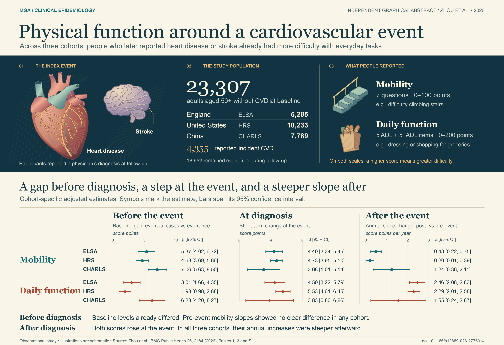
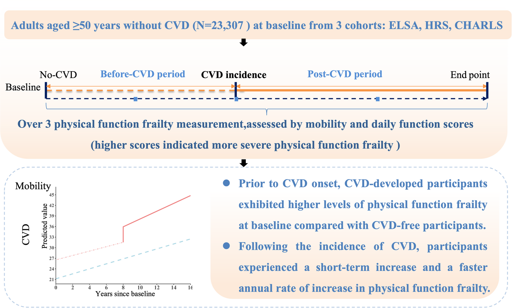
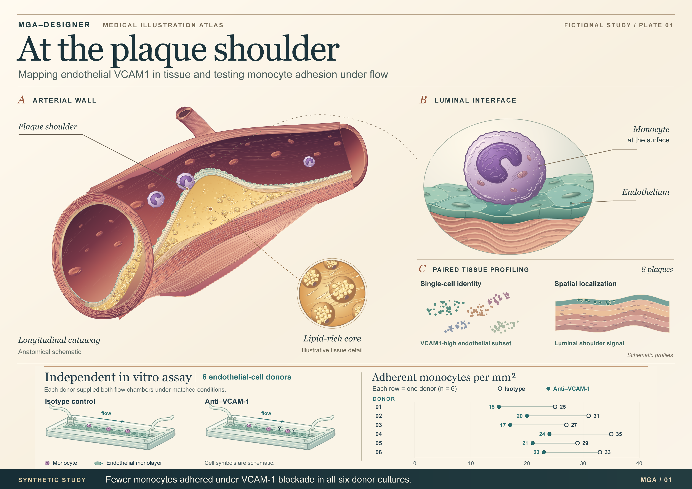
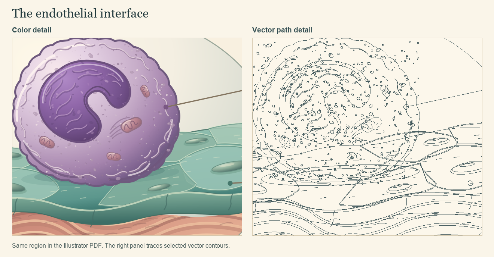

# MGA-Designer

**医学图像摘要设计助手**（Medical Graphical Abstract Designer） · [English](../README.md) | 简体中文

给 MGA-Designer 一篇医学论文和相应的结果表，它会帮你把主要发现画成一张**可以在 Adobe Illustrator 里继续修改的图像摘要**。开画前，你会先看到草图，知道每个结论来自哪里、为什么选这种画法，以及哪些内容更适合留在正文里。

[下载](https://github.com/hujizhou35-cmd/MGA-Designer/releases/latest) · [按文章类型选构图](#什么样的论文适合什么画法) · [怎么开始](#用自己的论文试一次) · [反馈](https://github.com/hujizhou35-cmd/MGA-Designer/issues)

## 同一篇已发表的论文，两种画法

第一次发生心血管事件前后，人的行动能力和日常生活能力有什么变化？Zhou 等人分析了英格兰、美国和中国三个队列的 23,307 名参与者。制作这组对照时，MGA-Designer 只根据论文正文、表格和补充材料独立绘制。Illustrator 成图定稿并存入 Git 后，我们才打开作者的图像摘要。

| MGA-Designer 独立绘制 | 论文作者发表的原版 |
| :---: | :---: |
| [](media/cvd-frailty.png) | [](media/zhou-2026-published.png) |

原版沿时间轴讲述从入组、确诊到随访结束的过程，用预测曲线概括行动能力的变化。独立稿先用爬楼和买菜解释两种评分，再分三栏展示每个队列在事件前、确诊时和事件后的结果。点击任一张图都可以放大。

[查看构图取舍与数据出处](cvd-frailty.md) · [下载可编辑的 Illustrator 源文件](media/cvd-frailty.ai?raw=true) · [打开矢量 PDF](media/cvd-frailty.pdf)

右图为论文原图，按原样转载。© 论文作者 2026，Zhou 等，*BMC Public Health* **26**，文章号 2184。该图单独适用 [CC BY-NC-ND 4.0 许可协议](https://creativecommons.org/licenses/by-nc-nd/4.0/deed.zh-hans)。[论文原文](https://doi.org/10.1186/s12889-026-27763-w)

## 再看一个基础实验案例

### 斑块肩部｜虚构教学案例

[](media/demo.png)

内皮细胞的 *VCAM1* 信号出现在斑块的什么位置？主图用动脉剖面标出八份虚构斑块标本的取样位置。阻断 VCAM-1 后，在流动条件下黏附的单核细胞数量会怎样变化？这是另一项体外实验，用的是另外六位供者的内皮细胞。计数图中，每条线都连接**同一位供者**在两种条件下的结果。这样画，读者就能分清哪项发现来自组织，哪项来自实验。

[查看设计说明与虚构实验数据](demo.md) · [下载可编辑的 Illustrator 源文件](media/plaque-atlas.ai?raw=true)

<details>
<summary>放大看看图中的矢量路径</summary>



左边是从导出 PDF 中截取的局部，右边是同一位置的矢量轮廓。用 Illustrator 打开源文件，就能单独选中路径、修改填色，或直接改图上的文字。

</details>

## 什么样的论文适合什么画法

| 论文类型 | 构图要解决的问题 |
| --- | --- |
| 叙述性综述 | 多个主题围绕同一个疾病或器官展开时，可以画成分区图。比较不同机制时，适合并排画。讨论病程或研究进展时，再用时间线。 |
| 系统综述、Meta 分析 | 先交代比较的对象和主要结局，再画综合结果。有合并效应量就给出置信区间；如果异质性或证据质量会改变结论，也要让读者看得到。 |
| 临床观察性研究、临床公共数据库研究 | 从人群入手，画清暴露和结局各是怎么测的，再展示主要比较。涉及多个队列时，要标明每项分析究竟用了哪个队列。 |
| 临床预测模型 | 把建模和验证分开，注明每个性能指标来自训练集、内部验证还是外部测试。 |
| GEO 等组学研究，或组学结合实验 | 分清发现集、独立验证集和后续实验。实验如果只验证了表达差异，箭头就连到表达差异这一项。 |
| 基础实验 | 先交代做了什么干预、和谁比较、测了什么。实验证据足以支持调控关系时，再画机制图。 |
| 文献计量研究 | 先界定文献范围。研究热点随时间的变化可以画成时间线，作者合作关系可以画成网络，并注明节点和连线的含义。 |

[查看完整的 11 种构图方案（英文）](../skills/mga-designer/references/layout-choices.md)

## 用自己的论文试一次

1. **连上 Illustrator。** 助手通过 Illustrator MCP 服务向你电脑上的 Illustrator 发送绘制指令。首次使用时，它会在临时文档中建图层、画形状、写文字，保存为 AI 文件，再重新打开并查看导出效果。以后可以复用这套环境。
2. **读论文，核对证据。** 助手一起读正文、图表和必要的补充材料，理清每个方法用了哪些样本、回答什么问题、得到了什么结果。图上的关键数字都要能查回原文，遇到数字冲突会先核实。
3. **找同类论文，看实际成图。** 助手会打开研究问题和设计相近的已发表作品，说明哪些画法值得借鉴。如果你指定了目标期刊，它还会查询该刊的图片规格和对 AI 辅助制图的要求。
4. **由你确认方案。** 你会看到草图、选择这种构图的理由，以及一张取舍表，列清保留什么、合并什么、什么移到图注或省去。例如，第二个队列是重复检验同一关联，还是用来验证已建好的模型？你可以先检查草图中的箭头是否画对，再决定是否精绘。
5. **绘制并检查成图。** 助手在 Illustrator 中分层绘制，保留可编辑的路径和文字。交付前会重开源文件，对照原文核对数值，再按实际阅读尺寸查看有无裁切、重叠或字太小。默认交付 **AI 源文件、矢量 PDF、PNG 预览图和简短的核查说明**。

把论文和核对结果所需的表格或补充材料交给助手。如果已有目标期刊，也请写出刊名。在 Codex 里可以直接说：

> 请用 $mga-designer 为这篇论文设计图像摘要。先画出研究对象、测量方法和主要发现之间的关系，解释为什么这样排、哪些细节可以省略。等我确认草图后再精绘。

## 三种下载方式，选一种就够

| 下载文件 | 适合谁 | 如何使用 |
| --- | --- | --- |
| [单文件 SKILL.md](https://github.com/hujizhou35-cmd/MGA-Designer/releases/latest/download/SKILL.md) | 想把完整指令交给能读取 Markdown 的助手 | 将文件作为附件交给助手。工作流程和配套指南都已包含在内。 |
| [Codex 项目技能包](https://github.com/hujizhou35-cmd/MGA-Designer/releases/latest/download/mga-designer.skill) | 想在一个项目中调用这项技能 | 解压后，项目目录下应当能找到 `.agents/skills/mga-designer/SKILL.md`。解压工具不识别时，可先把下载文件的后缀改为 `.zip`。随后在该项目中新建对话。 |
| [Codex 插件包](https://github.com/hujizhou35-cmd/MGA-Designer/releases/latest/download/mga-designer-plugin.zip) | 习惯用 Codex 插件管理功能安装 | 将压缩包解压到一个会保留的文件夹，在该文件夹打开终端，依次执行下面两条命令。 |

```sh
codex plugin marketplace add .
codex plugin add mga-designer@mga-designer-local
```

**绘图需要安装什么？** 技能文件告诉助手该怎样分析和绘图。要实际生成 AI 源文件，助手还要能连接一台装有正版 Adobe Illustrator、Node.js 和 Illustrator MCP 服务的电脑。MCP 服务负责把指令交给 Illustrator，由 Illustrator 创建对象、保存和导出文件。检索论文和期刊要求需要联网；暂时没有 Illustrator 时，仍然可以先分析论文、讨论草图。

<details>
<summary>第一次在 Windows 上用 Codex 连接 Illustrator</summary>

先在桌面打开 Illustrator，再打开 PowerShell，查看 Node.js 版本和 Codex 已配置的 MCP 服务。Illustrator MCP 要求 Node.js 20 或更高版本。

```powershell
node --version
codex mcp list
```

如果列表中已有 Illustrator 服务，直接复用即可。如果还没有，运行下面这条命令，注册本项目实测过的版本。

```powershell
codex mcp add illustrator -- cmd /d /c npx -y illustrator-mcp-server@1.10.3
```

在 Codex 中新建对话，请 MGA-Designer 在空白文档里画一个形状、写一行可编辑文字，保存为 AI 文件，重新打开，再给你看导出的 PNG。看到结果，就说明指令确实传到了 Illustrator。

</details>

**实测环境。** 在 Windows 上，用 Illustrator 2023（27.5.0）、Node.js 24.16.0 和 Illustrator MCP 1.10.3 实测了绘制路径、编辑文字、保存并重开 AI 文件，以及导出 PDF、PNG 和 SVG。如果某个必要操作通过 MCP 无法完成，助手会说明失败的步骤，征得你同意后才改用 Illustrator 原生脚本。[连接方法与 Windows 命令（英文）](../skills/mga-designer/references/illustrator.md) · [Illustrator MCP 项目](https://github.com/ie3jp/illustrator-mcp-server)

使用时遇到问题，或希望补充某类论文的画法，欢迎[在 Issues 留言](https://github.com/hujizhou35-cmd/MGA-Designer/issues)。技能采用 [MIT 许可证](../LICENSE)。
