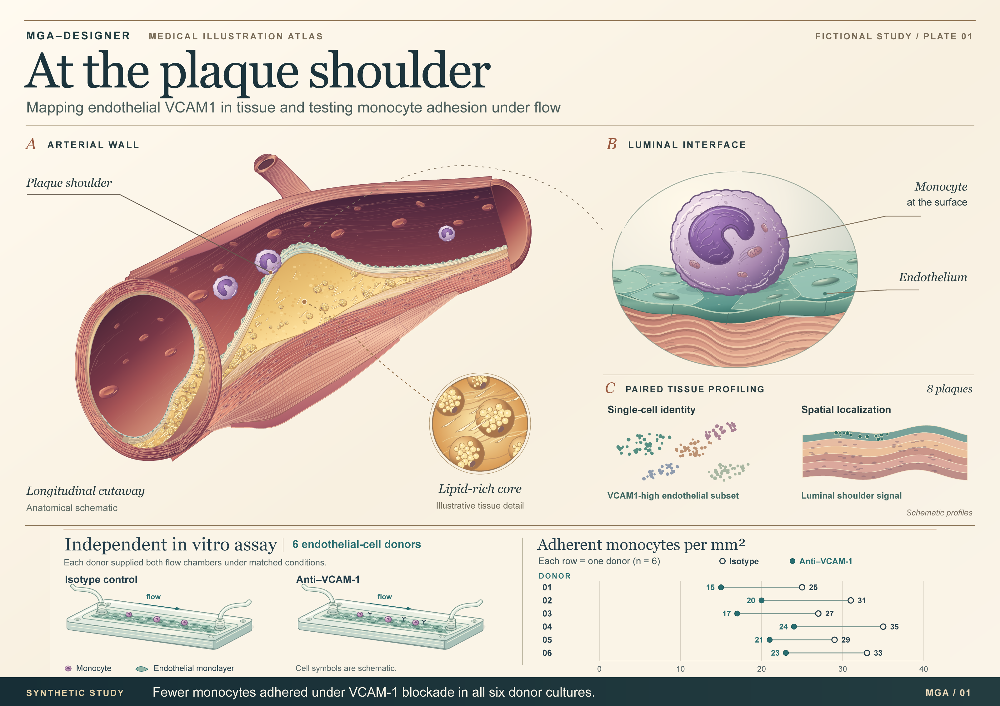
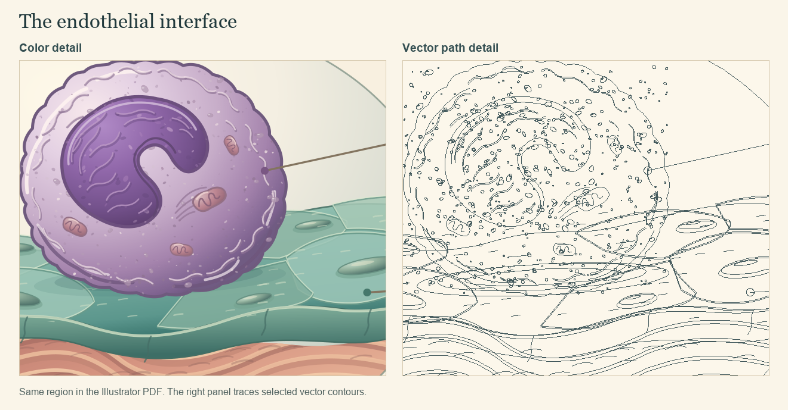

# At the plaque shoulder

**An author-approved graphical abstract for an entirely fictional study.** All eight plaque specimens, all six independent endothelial-cell donors and all counts were invented for teaching. The example contains no human research results or clinical validation.

[Download the editable Illustrator file](media/plaque-atlas.ai?raw=true) · [English project guide](../README.md) · [中文项目说明](README.zh-CN.md)



The arterial cutaway locates the plaque shoulder. Following the magnified cell surface and tissue insets answers the anatomical question. The independent experiment below asks a different question about adhesion. The six rows of its plot reproduce the count table on this page.

## A. What the figure shows

The example asks two questions. Where does endothelial *VCAM1* appear in an arterial plaque? How many monocytes remain attached when VCAM-1 is blocked in an independent cell experiment?

| Evidence | Source and comparison | What the figure shows |
| --- | --- | --- |
| Cell identity and location | Take paired portions from each of eight fictional arterial plaque specimens. Use one for single-cell RNA profiling and the other for spatial localization. | The tissue scene places the endothelial *VCAM1* signal at the luminal plaque shoulder. Both profiling views are schematic. |
| Monocyte adhesion under flow | Use endothelial cells from six separate, fictional cell donors. Split each donor's cells between isotype control and VCAM-1 blocking antibody under matched flow-chamber conditions. Count adherent monocytes per mm². | In the invented assay counts, adhesion is lower with the blocking antibody for all six paired donors. The comparison applies to the cultured-cell experiment. |

**Reading path**

```text
8 plaque specimens → paired portions → single-cell profiling ─┐
                                     spatial localization ────┴→ luminal plaque shoulder

6 independent endothelial-cell donors → matched flow chambers → two counts per donor
                                        isotype / anti-VCAM-1   (adherent monocytes/mm²)
```

The upper branch assigns two methods to portions of each specimen. The lower branch starts with its own cell donors. Each line joining two count marks in that branch stands for **one donor measured under both conditions**. The shared target name links the questions conceptually. No material passes between branches.

### Synthetic count data for the flow chamber

| Cell donor | Isotype control, cells/mm² | VCAM-1 blockade, cells/mm² | Within-donor decrease, cells/mm² |
| --- | ---: | ---: | ---: |
| 1 | 25 | 15 | 10 |
| 2 | 31 | 20 | 11 |
| 3 | 27 | 17 | 10 |
| 4 | 35 | 24 | 11 |
| 5 | 29 | 21 | 8 |
| 6 | 33 | 23 | 10 |

Each decrease is the control count minus the blockade count for the same donor. The median of the six decreases is **10 adherent monocytes/mm²**.

## Published visual references

| Image inspected | What informed this composition | Where the analogy ends |
| --- | --- | --- |
| Bleckwehl et al., *Nature Cardiovascular Research* (2025), main-text study overview. [Figure 1](https://doi.org/10.1038/s44161-024-00582-1) | The opening schematic keeps single-cell and spatial data in distinct streams. In the teaching figure, the cell-type inset and the tissue inset share an anatomical landmark. | The published cluster coordinates, tissue spots and cohort design belong to that study. Both insets here are schematic. |
| Schimmel et al., *Cell Reports* (2018), graphical abstract. [Original illustration](https://ars.els-cdn.com/content/image/1-s2.0-S2211124718313317-fx1.jpg) | Repeating an endothelial surface at one scale makes the difference between conditions readable. Both flow chambers use the same viewpoint, with donor counts on their own axis. | The published stiffness, ICAM-1 and transmigration mechanism does not enter the fictional assay. |
| Su et al., *Nature Cardiovascular Research* (2025), graphical abstract published as Extended Data Fig. 9. [Original illustration](https://www.nature.com/articles/s44161-024-00591-0/figures/16) | The cell boundary separates external stimuli, intracellular readouts and surface adhesion. Here the transcript signal belongs inside the tissue inset and antibody treatment belongs to the independent culture experiment. | The IGFBP6 signaling model and disease endpoint are specific to that paper. The fictional counts address adhesion in culture. |

## B. Why this visual form

The cutaway places the endothelial lining on the blood-facing surface of the plaque. Two small schematic insets distinguish the cell identity from its anatomical location. The gene symbol *VCAM1* identifies the transcript signal.

In the arterial window, the plaque shoulder leads to a magnified view of one monocyte at the endothelial surface. A smaller inset explains the anatomy of the lipid-rich core. The foam cells, clefts and organelles provide orientation and carry no measured abundance or dimensions. Violet identifies the monocyte from the artery down to the glass chambers.

The independent flow-chamber drawings sit beside a paired dot plot with a shared horizontal count axis. Each row contains one donor's control and blockade results, labeled with both values. The chamber scene explains what the six comparisons measure. The protein name VCAM-1 identifies the antibody target.

## C. What stays, what moves to the caption

| Item | Author-approved treatment | Reason |
| --- | --- | --- |
| Source of tissue, paired sampling and luminal orientation | Keep in the tissue branch. | Readers need to see the anatomical location and understand how the two tissue methods are related. |
| Single-cell and spatial panels | Draw original schematics and label both as schematic. | No cell matrix, embedding coordinates, spatial measurements or microscopy were generated. A numerical color scale, UMAP axes or a micrograph would imply unavailable data. |
| Independent endothelial-cell donors, isotype control and blocking antibody | Keep together in the assay branch. | These identify the in vitro comparison and keep its donors distinct from the tissue specimens. |
| Individual adhesion counts and their units | Keep all six pairs on a common scale. Put the arithmetic in this page or the caption. | Showing the pairing allows the reader to verify both the direction and the range of differences. |
| Patient outcomes, therapeutic efficacy, statistical significance and omitted assay settings | Leave out. | The brief supplies synthetic counts and a conceptual tissue signal. It supplies no clinical outcomes, prespecified inferential analysis, flow rate or antibody concentration. |

## Editable artwork



The approved original SVG artwork was opened through the Illustrator MCP server, organized into seven named Illustrator layers, saved as AI and reopened in Illustrator 2023 (27.5.0). The reopened master contains 66 editable text frames and no placed raster images. The paired values were checked again on the PDF and on the 3200 × 2260 PNG.

The two detail panels cover the same area. The left panel is a crop of the Illustrator PDF. The right panel shows contours extracted from vector paths in that crop. Open the full-resolution preview to read the six pairs, or select individual objects in Illustrator. [Full-resolution PNG](media/demo.png) · [Illustrator master](media/plaque-atlas.ai?raw=true)
